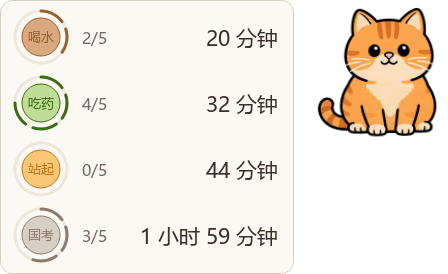
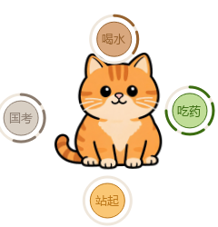
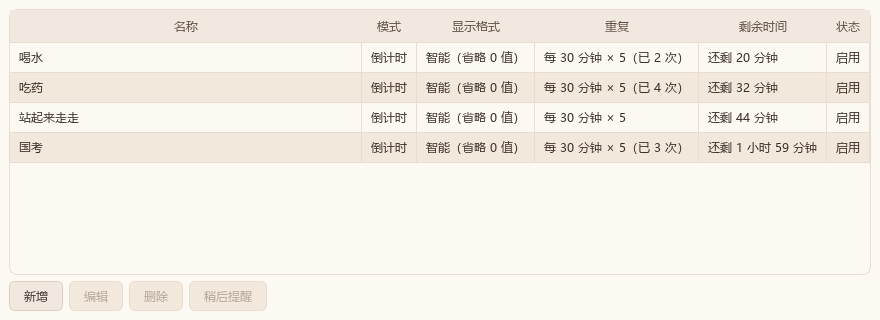
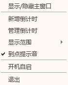

# Desktop Pet Timer

English | [简体中文](README.md)

An orange cat sits on your desktop and keeps an eye on your water breaks,
sitting time, and important deadlines.



## Features

- **Recurring reminders** — every N minutes, N times per day, auto-resets daily, active hours (e.g. 09:00–18:00)
- **Three scenarios** — drink water, stand up and move, one-off deadlines
- **Pet interaction** — breathing, click bounce, head tilt, click the cat to collapse the card
- **Auto-hide in fullscreen** — three visibility modes (desktop only / windows visible / always visible)
- **Notification sound** — falls back to the system sound when no WAV is present

## Screenshots

| Expanded | Collapsed |
|---|---|
|  |  |

| Manager | Tray menu |
|---|---|
|  |  |

## Install

Download `Setup.exe` and run it. **No administrator rights required** — it installs into your user directory and never writes to the system registry.

## Development

```bat
python -m venv .venv
.venv\Scripts\pip install -r requirements.txt
启动.bat
```

Double-click `启动.bat` after editing code. It launches via `pythonw` with no console window; crashes are written to `启动错误.log`.

## Stack

Python 3.12 · PySide6 · PyInstaller · Inno Setup

## License

[MIT](LICENSE)
